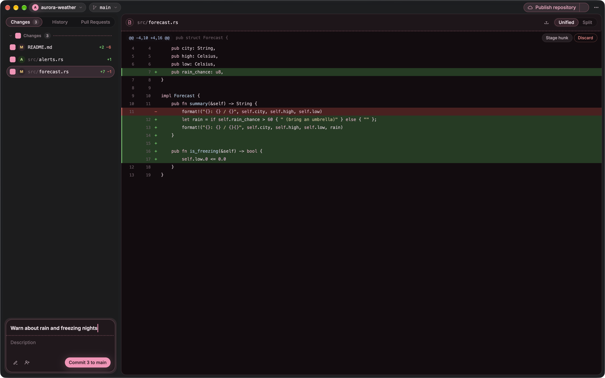
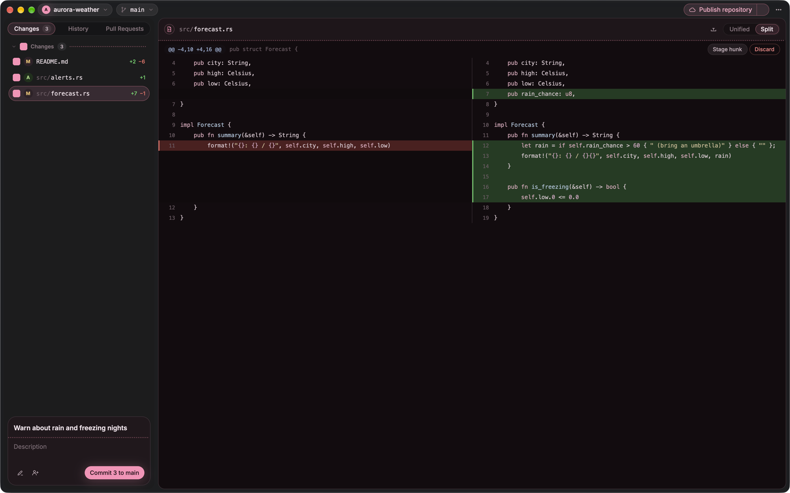
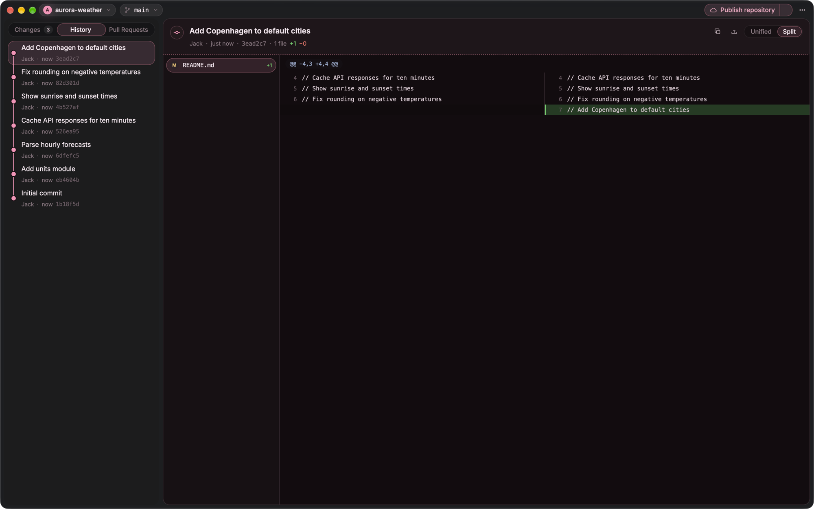
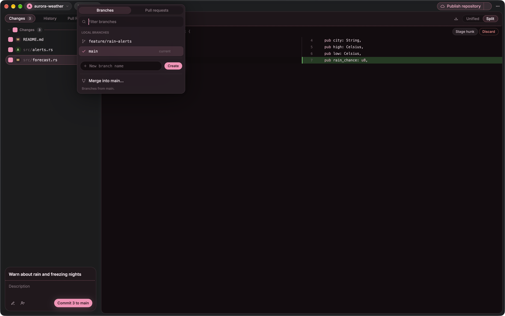

<p align="center">
  
</p>

<h1 align="center">WackDepot</h1>

<p align="center">
  A friendly, fast Git app for your Mac.<br>
  Everything you liked about GitHub Desktop, rebuilt from scratch as a truly native app.
</p>

<p align="center">
  
</p>

## Why WackDepot?

Most desktop Git apps these days are a web page wearing an app costume. They ship a whole browser engine, eat a few hundred megabytes of memory sitting idle, and your laptop fan knows when they're open.

WackDepot isn't built that way. It's written entirely in Rust on a fork of [gpui](https://github.com/zeronsh/zui), the GPU-accelerated UI framework behind the Zed editor. No Electron, no Tauri, no web view, no JavaScript. Just a native app that draws straight to your GPU.

What that means for you:

- **It opens instantly** and stays snappy, even on big repositories with long histories.
- **It's light on memory**, so it can sit open all day next to everything else you run.
- **It's kind to your battery.** The app only redraws when something actually changes, so it sits quietly when you're not using it.

It also looks like it belongs on your Mac, with macOS's Liquid Glass window, proper keyboard shortcuts and real menus. And the little animations make it more fun to use.

## What it does

### Review and commit your changes

See every edited file at a glance, with a clean diff for each one. Tick the files you want, write a summary and commit. You can stage a single hunk or even individual lines when you only want part of a change, and discard the bits you don't want. Amending your last commit and adding co-authors take one click.

<p align="center">
  
</p>

Prefer seeing old and new code side by side? Flip between unified and split views. Code is syntax highlighted, word-level changes are picked out, and changed images show up side by side too.

### Browse your history

Scroll through every commit with a branch graph alongside, and click any commit to see exactly what it changed. From there you can revert a commit, cherry-pick it onto another branch, or reset back to it.

<p align="center">
  
</p>

### Branches, syncing and the rest of the everyday stuff

Create, switch and merge branches from the picker in the title bar. Fetch, pull and push with one button, and watch progress as it happens. Stash work in progress for later. When a merge or rebase hits a conflict, WackDepot walks you through it and lets you pick your version or theirs.

<p align="center">
  
</p>

### GitHub built in

Sign in to GitHub and you get a full Pull Requests workspace inside the app. Open new pull requests, read the diff, leave inline review comments, follow the conversation, check CI status and merge when everything's green.

### Starting something new

Clone a repository, or create a new one with a README, a `.gitignore` from GitHub's template collection and a license picked from the same list GitHub offers. Pin the repos you use most so they're always at the top of the picker, or point WackDepot at a folder and it'll find every repository inside it.

## Works with the Git you already have

WackDepot uses the `git` already installed on your Mac. Your existing config, SSH keys and credential helpers all keep working, and nothing is locked away in a format only WackDepot understands. Anything you do here, you could have done in Terminal, and the other way round.

## Requirements

- A Mac with Apple silicon (M1 or newer)
- macOS, with Git installed (if you don't have it, running `git` in Terminal once will offer to install Apple's command line tools)

## Getting it

WackDepot is in early development, so expect some rough edges. Ready-made downloads will appear on the [Releases](https://github.com/Intelios/wackdepot/releases) page. Until then, you can build it yourself if you have [Rust](https://rustup.rs) installed:

```sh
git clone https://github.com/Intelios/wackdepot.git
cd wackdepot
sh scripts/bundle.sh
open dist/WackDepot.app
```

## Part of the Wack family

WackDepot is the sibling of [WackCode](https://github.com/Intelios/wackcode), a playful, local-first Mac app for the Pi coding agent, where an AI agent works on your projects with you. Bring your own model, no account needed. The two share the same design language, so they feel at home next to each other. WackCode writes the code, and WackDepot is a nice place to review and commit it.

## Feedback

Found a bug or have an idea? [Open an issue](https://github.com/Intelios/wackdepot/issues). It really helps.

For anyone hacking on the code, developer setup and GitHub OAuth notes live in [docs/GITHUB_SETUP.md](docs/GITHUB_SETUP.md). Credits for the open source pieces WackDepot builds on are in [THIRD_PARTY_NOTICES.md](THIRD_PARTY_NOTICES.md).
